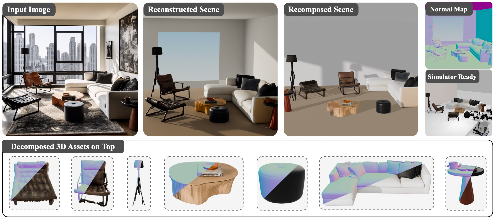

<div align="center">

<h1>🧩 CoLa3D: Composable Latent 3D Decomposition</h1>

<p><strong>Accepted at NeurIPS 2026</strong></p>

<p>
  <a href="https://master-cai.github.io/">Xudong Cai</a><sup>1,3</sup>,
  <a href="https://yongcaiwang.github.io/index_en.html">Yongcai Wang</a><sup>1,2</sup>,
  <a href="https://info.ruc.edu.cn/jsky/szdw/ajxjgcx/jsjkxyjsx1/js2/c2523870862c49758d02a6705c1e1556.htm">Deying Li</a><sup>1</sup>,
  <a href="https://physicalvision.github.io/people/~chuanxia">Chuanxia Zheng</a><sup>3</sup>
</p>
<p>
  <sup>1</sup>School of Information, Renmin University of China<br>
  <sup>2</sup>Hebei Key Laboratory of Real-virtual Integrated Autonomous Systems (RIAS)<br>
  <sup>3</sup>PVG, Nanyang Technological University
</p>

<p>
  
  <a href="https://arxiv.org/abs/2611.03533"></a>
  <a href="https://master-cai.github.io/CoLa3D/"></a>
  <a href="https://huggingface.co/mastercai/CoLa3D"></a>
  <a href="https://huggingface.co/datasets/mastercai/CoLa3D-Benchmarks"></a>
  <a href="https://huggingface.co/datasets/mastercai/CoLa3D-Training"></a>
  <a href="LICENSE"></a>
</p>

<br>



</div>

> **CoLa3D** generates a 3D scene from a single image and decomposes it into
> individual object meshes in a shared coordinate frame, supporting Free, Point, and Mask prompts.

This repository includes training and inference code, data preparation tools, and a evaluation package.

If you find CoLa3D useful, please consider giving this repository a star!

<a id="installation"></a>

## 🛠️ Installation

From the repository root, on Linux with an NVIDIA GPU, CUDA 12.8, a compatible
C++ compiler, and Conda:

```bash
./setup.sh --new-env --all --eval --moge
conda activate "$PWD/.env"
```

Use `./setup.sh --ui` for interactive point selection or `./setup.sh --data` for
training data preparation. See `./setup.sh --help` for installation options.

<a id="quick-demo"></a>

## 🚀 Quick Demo

Try the demo image with Free, Mask, or Point prompts:

```bash
python scripts/inference/demo.py --mode free
python scripts/inference/demo.py --mode mask
python scripts/inference/demo.py --mode point
```

Generated object meshes are saved under `outputs/demo/<mode>/image/geometry/post_standard/`.

<a id="evaluation"></a>

## 📊 Evaluation

<a id="download-the-benchmark"></a>

### 📥 Download the benchmark

Download and extract the five benchmark archives from the repository root:

```bash
hf download mastercai/CoLa3D-Benchmarks --repo-type dataset --include 'archives/*.tar.zst' --local-dir .
python scripts/data/extract_benchmarks.py --archive-dir archives --output-dir .
```

For 3D-FRONT Point inference, set `BLENDER_PATH` to a Blender 4.5 executable.

<a id="run-inference"></a>

### 🚀 Run inference

One command runs Free, Point, and Mask on all five datasets:

```bash
export BLENDER_PATH="/path/to/blender"
./scripts/inference/run_all_inference.sh
```


<a id="compute-metrics"></a>

### 📏 Compute metrics

```bash
./scripts/eval/evaluate_all.sh
```

The bundled [`mesh_eval/`](mesh_eval/) package computes scene- and object-level
Chamfer distance, F-score or recall, and bounding-box IoU. Summaries are written to `results/<dataset>/<mode>/table.json`, alongside
full metrics and per-scene records.

To run only one subset, pass its name to both scripts. For example, MetaScenes Hard:

```bash
./scripts/inference/run_all_inference.sh metascenes_hard
./scripts/eval/evaluate_all.sh metascenes_hard
```

Available subsets: `3dfront`, `metascenes`, `replica`, `scannetpp`, and `metascenes_hard`.
Both scripts also accept multiple subset names separated by spaces. Set `NUM_WORKERS`
to increase CPU evaluation parallelism.

<a id="training"></a>

## 🏋️ Training

See the [training guide](docs/TRAINING.md) for data download, preprocessing,
and training commands.

<a id="citation"></a>

## 📜 Citation

If you find our work useful, please cite:

```bibtex
@inproceedings{cai2026cola3d,
  title     = {CoLa3D: Composable Latent 3D Decomposition},
  author    = {Xudong Cai and Yongcai Wang and Deying Li and Chuanxia Zheng},
  booktitle = {Advances in Neural Information Processing Systems},
  year      = {2026}
}
```

<a id="acknowledgements"></a>

## 🤝 Acknowledgements

CoLa3D builds on [TRELLIS.2](https://github.com/microsoft/TRELLIS.2),
[DINOv3](https://github.com/facebookresearch/dinov3),
[Utonia](https://github.com/Pointcept/Utonia), and
[MoGe](https://github.com/microsoft/MoGe). We thank their authors and the creators
of the datasets used in this project.

<a id="license"></a>

## 📄 License

The code is distributed under the [MIT License](LICENSE). Third-party code,
pretrained models, and datasets retain their respective licenses and access terms.
